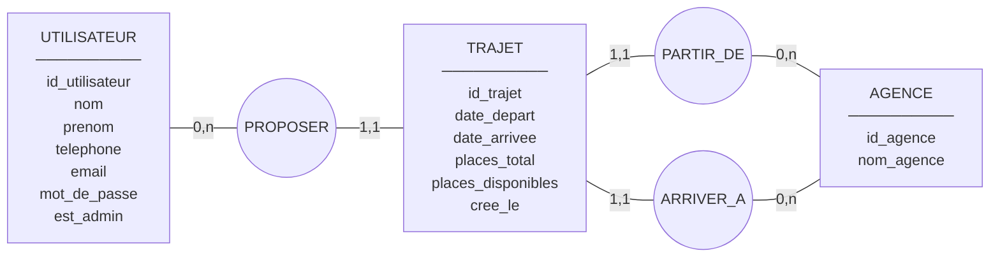

# Conception de la base de données (Merise)

## 1. Dictionnaire des données

| Code               | Libellé                              | Type           | Contraintes                         | Entité      |
|--------------------|--------------------------------------|----------------|-------------------------------------|-------------|
| id_utilisateur     | Identifiant de l'employé             | Entier         | Identifiant                         | UTILISATEUR |
| nom                | Nom de l'employé                     | Texte (50)     | Obligatoire                         | UTILISATEUR |
| prenom             | Prénom de l'employé                  | Texte (50)     | Obligatoire                         | UTILISATEUR |
| telephone          | Téléphone                            | Texte (20)     | Obligatoire                         | UTILISATEUR |
| email              | Adresse email (identifiant de login) | Texte (150)    | Obligatoire, unique                 | UTILISATEUR |
| mot_de_passe       | Hash du mot de passe                 | Texte (255)    | Obligatoire, `password_hash()`      | UTILISATEUR |
| est_admin          | Rôle administrateur                  | Booléen        | Défaut : faux                       | UTILISATEUR |
| id_agence          | Identifiant de l'agence              | Entier         | Identifiant                         | AGENCE      |
| nom_agence         | Nom de la ville / agence             | Texte (100)    | Obligatoire, unique                 | AGENCE      |
| id_trajet          | Identifiant du trajet                | Entier         | Identifiant                         | TRAJET      |
| date_depart        | Date et heure de départ              | Date-heure     | Obligatoire                         | TRAJET      |
| date_arrivee       | Date et heure d'arrivée              | Date-heure     | Obligatoire, > date_depart          | TRAJET      |
| places_total       | Nombre total de places               | Entier         | 1 à 9                               | TRAJET      |
| places_disponibles | Nombre de places disponibles         | Entier         | 0 à places_total                    | TRAJET      |
| cree_le            | Date de création                     | Date-heure     | Défaut : maintenant                 | TRAJET      |

## 2. Règles de gestion

1. Un employé peut proposer zéro, un ou plusieurs trajets.
2. Un trajet est proposé par un et un seul employé (son auteur).
3. Un trajet part d'une et une seule agence.
4. Un trajet arrive à une et une seule agence, différente de l'agence de départ.
5. Une agence peut être le point de départ de zéro, un ou plusieurs trajets.
6. Une agence peut être le point d'arrivée de zéro, un ou plusieurs trajets.
7. Une agence utilisée par au moins un trajet ne peut pas être supprimée.
8. Seul l'auteur d'un trajet peut le modifier ; l'auteur et l'administrateur peuvent le supprimer.

## 3. MCD (modèle conceptuel des données)

Trois entités et trois associations nommées. Les cardinalités se lisent
« entité → association » (minimum, maximum).

```
 ┌──────────────────┐                                     ┌──────────────────┐
 │   UTILISATEUR    │                                     │      TRAJET      │
 ├──────────────────┤          ╭────────────╮             ├──────────────────┤
 │ id_utilisateur   │ 0,n      │            │      1,1    │ id_trajet        │
 │ nom              ├──────────┤  PROPOSER  ├─────────────┤ date_depart      │
 │ prenom           │          │            │             │ date_arrivee     │
 │ telephone        │          ╰────────────╯             │ places_total     │
 │ email            │                                     │ places_disponib. │
 │ mot_de_passe     │                                     │ cree_le          │
 │ est_admin        │                                     └───┬─────────┬────┘
 └──────────────────┘                                     1,1 │         │ 1,1
                                                              │         │
                                                   ╭──────────┴─╮   ╭───┴────────╮
                                                   │ PARTIR_DE  │   │ ARRIVER_A  │
                                                   ╰──────────┬─╯   ╰───┬────────╯
                                                          0,n │         │ 0,n
                                                          ┌───┴─────────┴────┐
                                                          │      AGENCE      │
                                                          ├──────────────────┤
                                                          │ id_agence        │
                                                          │ nom_agence       │
                                                          └──────────────────┘
```

| Association | Entité A    | Card. A | Entité B | Card. B | Lecture                                                         |
|-------------|-------------|---------|----------|---------|-----------------------------------------------------------------|
| PROPOSER    | UTILISATEUR | 0,n     | TRAJET   | 1,1     | Un employé propose 0..n trajets ; un trajet a exactement 1 auteur |
| PARTIR_DE   | AGENCE      | 0,n     | TRAJET   | 1,1     | Une agence est le départ de 0..n trajets ; un trajet a 1 départ   |
| ARRIVER_A   | AGENCE      | 0,n     | TRAJET   | 1,1     | Une agence est l'arrivée de 0..n trajets ; un trajet a 1 arrivée  |

La même représentation au format Mermaid (rendue par GitHub / VS Code) :



## 4. MLD (modèle logique des données)

Règle de passage : une association binaire de type (0,n)–(1,1) disparaît ; la
clé primaire de l'entité côté « n » migre en clé étrangère dans l'entité côté
« 1,1 ». Les trois associations deviennent donc trois clés étrangères de
TRAJET. Clé primaire soulignée, clé étrangère précédée de `#`.

- **utilisateurs** (<u>id</u>, nom, prenom, telephone, email, mot_de_passe, est_admin)
- **agences** (<u>id</u>, nom)
- **trajets** (<u>id</u>, #utilisateur_id, #agence_depart_id, #agence_arrivee_id, date_depart, date_arrivee, places_total, places_disponibles, cree_le)
  - `utilisateur_id` → `utilisateurs.id` (PROPOSER)
  - `agence_depart_id` → `agences.id` (PARTIR_DE)
  - `agence_arrivee_id` → `agences.id` (ARRIVER_A)

## 5. MPD (modèle physique des données)

Le script complet est [`database/01_schema.sql`](../database/01_schema.sql)
(MySQL 8 / MariaDB, moteur InnoDB, `utf8mb4`). Choix physiques :

| Règle                                   | Implémentation                                                     |
|-----------------------------------------|--------------------------------------------------------------------|
| Email unique                            | `CONSTRAINT uq_utilisateurs_email UNIQUE (email)`                  |
| Nom d'agence unique                     | `CONSTRAINT uq_agences_nom UNIQUE (nom)`                           |
| Agence utilisée non supprimable (R7)    | `FOREIGN KEY ... REFERENCES agences (id) ON DELETE RESTRICT`       |
| Suppression d'un employé                | `ON DELETE CASCADE` : ses trajets sont supprimés avec lui          |
| Départ ≠ arrivée (R4)                   | `CHECK (agence_depart_id <> agence_arrivee_id)`                    |
| Arrivée après le départ                 | `CHECK (date_arrivee > date_depart)`                               |
| Places cohérentes                       | `CHECK (places_total >= 1 AND places_disponibles <= places_total)` |
| Liste des trajets à venir triée         | `INDEX idx_trajets_date_depart (date_depart)`                      |
| Mots de passe                           | `VARCHAR(255)` pour stocker le hash `password_hash()`              |

Les règles sont aussi vérifiées côté PHP (`App\Validators\TrajetValidator`,
`App\Validators\AgenceValidator`) pour afficher un message clair à
l'utilisateur ; la base reste le dernier garde-fou.

## 6. Scripts

| Fichier                              | Rôle                                                            |
|--------------------------------------|-----------------------------------------------------------------|
| `database/00_create_database.sql`    | `DROP DATABASE IF EXISTS` + `CREATE DATABASE tpak`              |
| `database/01_schema.sql`             | `DROP TABLE IF EXISTS` + `CREATE TABLE` (rejouable)             |
| `database/02_seed.sql`               | Jeu d'essai : 12 agences, 20 employés, 6 trajets                |
| `database/03_create_admin.sql`       | Compte administrateur (rejouable)                               |

Le jeu d'essai provient de `data/jeu-d-essais/agences.txt` et
`data/jeu-d-essais/users.txt`.
